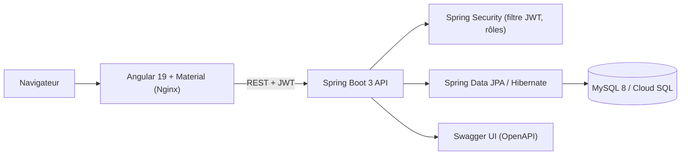

# ClinicPRO

ClinicPRO est une application web de gestion médicale pour une clinique. Le projet sépare clairement le back-end REST Spring Boot et le front-end Angular. Il couvre la prise de rendez-vous en ligne, la gestion du dossier médical électronique, la génération de factures après consultation et un système de notifications simulées pour les rappels de rendez-vous.


## Fonctionnalités

- Authentification JWT avec séparation des espaces par rôle.
- Espace patient : inscription, prise de rendez-vous, consultation des rendez-vous et factures.
  - Le client (patient) peut consulter ses factures depuis son espace personnel.
- Espace médecin : agenda, saisie de consultation et gestion du dossier médical électronique.
- Espace administrateur : gestion des patients, médecins, rendez-vous et factures.
- Vérification des disponibilités lors de la prise de rendez-vous.
- Génération automatique de factures après consultation.
- Notifications simulées pour les rappels et annulations de rendez-vous.
- Documentation API avec Swagger UI.

## Architecture

Le projet respecte une séparation stricte entre l'API REST et l'interface utilisateur.

```text
ClinicPRO/
├── src/main/java/com/ClinicPRO/      # Back-end Spring Boot
├── src/main/resources/               # Configuration back-end
├── clinicpro-frontend/               # Front-end Angular
├── Dockerfile                        # Image Docker back-end
├── docker-compose.yml                # MySQL + back-end + front-end
├── clinicpro-frontend/Dockerfile     # Image Docker front-end
├── clinicpro-frontend/nginx.conf     # Nginx pour Angular routing
└── README.md
```

## Architecture



Le back-end suit une architecture en couches : `controllers` (REST) → `services` (règles métier) → `repositories` (JPA) → `entities`, avec des `dto` et `mapper` pour ne jamais exposer les entités directement. Entités principales : `Patient`, `Medecin`, `RendezVous`, `Consultation`, `Facture`, `AppUser` (+ `Role`).

## Choix de conception

- **Contrôle d'accès par rôle** (`PATIENT`, `MEDECIN`, `ADMIN`) appliqué côté serveur, pas seulement dans l'interface.
- **Disponibilité vérifiée à la réservation** pour éviter les doubles rendez-vous.
- **Facture générée automatiquement** à la clôture d'une consultation.
- **DTO + mappers** pour séparer le contrat d'API du modèle de persistance.
- **Configuration par variables d'environnement** : `APP_JWT_SECRET` remplace la clé de développement en production.

## Limites connues

- Les notifications de rappel sont **simulées** (pas d'envoi réel d'e-mail ou SMS).
- Le schéma est géré par `spring.jpa.hibernate.ddl-auto=update` ; une migration versionnée (Flyway/Liquibase) est préférable en production.
- La couverture de tests back-end est minimale (un seul fichier de test) ; prochaine étape : tests de services et d'intégration sécurité (`@WebMvcTest`, Testcontainers MySQL).
- Utiliser une valeur forte pour `APP_JWT_SECRET` dans tout déploiement public.

## Technologies

- Java 17
- Spring Boot 3
- Spring Security
- JWT
- Spring Data JPA / Hibernate
- MySQL 8
- Angular 19
- Angular Material
- Docker
- Nginx
- Google Cloud Run
- Cloud SQL MySQL
- Swagger / Springdoc OpenAPI

## Lancement avec Docker

Depuis la racine du projet :

```bash
docker-compose up --build
```

Services exposés :

```text
Frontend : http://localhost:4200
Backend  : http://localhost:8081
MySQL    : localhost:3306
Swagger  : http://localhost:8081/swagger-ui/index.html
```


## Lancement local

Créer une base MySQL :

```sql
CREATE DATABASE ClinicPRO;
```

Vérifier la configuration dans :

```text
src/main/resources/application.properties
```

Démarrer le back-end :

```bash
mvn spring-boot:run
```

Démarrer le front-end :

```bash
cd clinicpro-frontend
npm install
ng serve
```

URLs locales :

```text
Frontend : http://localhost:4200
Backend  : http://localhost:8081
Swagger  : http://localhost:8081/swagger-ui/index.html
```

## Liens publics (démo)

- Front-end (démo) : https://clinicpro-etfppa7d2q-ew.a.run.app
- Back-end (Swagger UI) : https://clinicpro-backend-etfppa7d2q-ew.a.run.app/swagger-ui/index.html


## Sécurité

ClinicPRO utilise JWT et trois rôles :

- `PATIENT` : rendez-vous, factures et informations personnelles.
- `MEDECIN` : agenda, consultations et dossier médical.
- `ADMIN` : supervision et gestion des utilisateurs métier.

Le dossier médical électronique contient des données sensibles. Sa modification est réservée aux rôles `MEDECIN` et `ADMIN`.

## Commandes utiles

Build front-end :

```bash
cd clinicpro-frontend
npm run build
```

Tests back-end :

```bash
mvn test
```

Arrêt Docker :

```bash
docker-compose down
```

Suppression des volumes Docker :

```bash
docker-compose down -v
```

## Auteur

**Mahdi Gharbi** — [GitHub](https://github.com/MahdiGH10) · [LinkedIn](https://linkedin.com/in/mahdi-gharbi-6891a5273)
